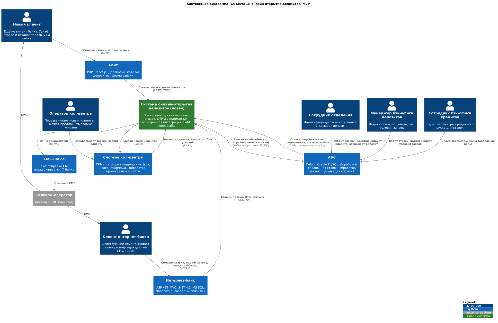
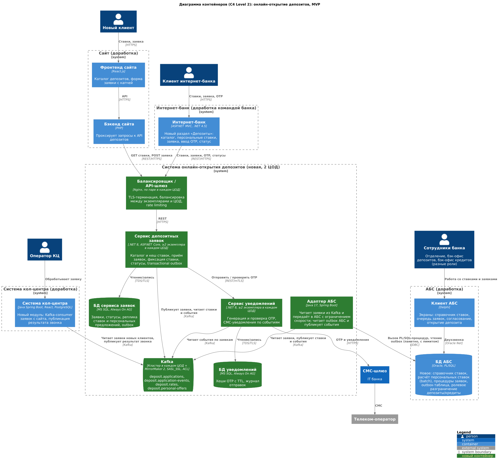

### **Название задачи:** Концептуальная архитектура онлайн-открытия депозитов (MVP) в банке «Стандарт»
### **Автор:** Коротков Константин
### **Дата:** 23.10.2026

**Статус:** предложено

**Контекст.** Сейчас депозит можно открыть только в отделении. Ставки рассчитываются вручную в XLS-файлах и передаются по почте, клиент ждёт в отделении от 20 минут до часа. Интернет-банк (монолит на .NET Framework 4.5 и платформе подрядчика) работает с АБС напрямую через её БД Oracle. При этом БД АБС уже перегружена и масштабируется только вертикально. Всё работает в одном ЦОД, переключение на резервный ЦОД ручное. Задача MVP: дать клиентам подавать заявки на депозит на сайте и в интернет-банке, не увеличивая нагрузку на АБС и обеспечив доступность 99,9% в режиме 24/7.

В скобках у требований и решений указаны коды из таблицы FURPS+.

### **Функциональные требования**

|**№**|**Действующие лица или системы**|**Use Case**|**Описание**|
| :-: | :- | :- | :- |
|UC1|Новый клиент, сайт, сервис депозитных заявок|Просмотр депозитов и ставок на сайте (F1)|1. Клиент открывает раздел «Депозиты» на сайте. 2. Бэкенд сайта запрашивает каталог у сервиса депозитных заявок. 3. Сервис отдаёт депозиты и актуальные ставки из своей БД (копия ставок из АБС), не обращаясь к АБС. 4. Сайт показывает список.|
|UC2|Новый клиент, сайт, сервис депозитных заявок, Kafka|Подача заявки новым клиентом на сайте (F2)|1. Клиент выбирает депозит, вводит Ф. И. О. и номер телефона. 2. Сайт передаёт заявку в сервис по HTTPS. 3. Сервис проверяет данные, сохраняет заявку со статусом «Новая» и запись в outbox в одной транзакции. 4. Событие публикуется в топик `deposit.applications`. 5. Клиент видит сообщение, что ему перезвонят.|
|UC3|Система КЦ, оператор КЦ, Kafka, адаптер АБС, АБС|Обработка заявки с сайта кол-центром (F3)|1. Модуль системы КЦ читает заявку из `deposit.applications` и создаёт обращение. 2. Оператор изучает заявку и звонит клиенту. 3. Если нужны особые условия, оператор отмечает это в обращении. Система КЦ публикует событие «Запрошены особые условия». 4. Адаптер АБС передаёт заявку в очередь бэк-офиса в АБС. 5. Оператор сообщает клиенту, что для открытия депозита нужен визит в отделение для идентификации.|
|UC4|Сотрудник отделения, АБС, адаптер АБС, сервис уведомлений|Идентификация и открытие депозита новому клиенту в отделении (F4, F9)|1. Клиент приходит в отделение. 2. Сотрудник находит заявку в АБС по телефону или Ф. И. О. 3. Сотрудник идентифицирует клиента по документам, заводит клиента и депозит в АБС. 4. АБС пишет событие «Депозит открыт» в outbox, адаптер публикует его в Kafka. 5. Сервис уведомлений отправляет клиенту СМС об открытии депозита.|
|UC5|Клиент, интернет-банк, сервис депозитных заявок|Просмотр депозитов, актуальных и персональных ставок в интернет-банке (F5)|1. Клиент открывает раздел «Депозиты» в интернет-банке. 2. Интернет-банк запрашивает у сервиса каталог и персональные предложения по идентификатору клиента. 3. Сервис отдаёт данные из своей БД. Персональные ставки заранее рассчитаны в АБС пакетно и переданы через Kafka. 4. Клиент видит общие и персональные ставки.|
|UC6|Клиент, интернет-банк, сервис депозитных заявок, сервис уведомлений, СМС-шлюз|Подача заявки в интернет-банке с подтверждением СМС-кодом (F6, F7)|1. Клиент выбирает депозит, счёт списания и сумму. 2. Интернет-банк передаёт черновик заявки в сервис. 3. Сервис запрашивает у сервиса уведомлений одноразовый код. Тот генерирует код, хранит его хеш с ограниченным сроком действия и отправляет СМС через шлюз. 4. Клиент вводит код, сервис проверяет его через сервис уведомлений. 5. После успешной проверки заявка получает статус «Подана» и публикуется в `deposit.applications`.|
|UC7|Адаптер АБС, АБС, менеджер бэк-офиса депозитов, сервис уведомлений|Обработка заявки и подтверждение ставки в бэк-офисе (F8, F9)|1. Адаптер АБС читает заявки из Kafka и вызывает PL/SQL-процедуру регистрации заявки с ограничением скорости. 2. Заявка попадает в очередь менеджера в клиенте АБС. 3. Менеджер вручную проверяет условия и подтверждает ставку. 4. АБС пишет событие «Ставка подтверждена» в outbox, адаптер публикует его в `deposit.application-events`. 5. Сервис уведомлений отправляет клиенту СМС.|
|UC8|Менеджер бэк-офиса депозитов, АБС, адаптер АБС, сервис депозитных заявок, сервис уведомлений|Открытие депозита по заявке из интернет-банка и отображение статуса (F8, F9, F10)|1. После подтверждения ставки менеджер открывает депозит в АБС и списывает сумму с указанного счёта. 2. АБС пишет событие «Депозит открыт» в outbox, адаптер публикует его в Kafka. 3. Сервис заявок обновляет статус заявки, сервис уведомлений отправляет СМС. 4. Клиент видит статус заявки в интернет-банке на каждом этапе: «Подана», «Ставка подтверждена», «Депозит открыт».|

### **Нефункциональные требования**

Пометка **[АЗТ]** означает архитектурно значимое требование.

|**№**|**Требование**|
| :-: | :- |
|U1|Интерфейс подачи заявки максимально удобен для клиента|
|U2|Интерфейсы сайта и интернет-банка соответствуют дизайн-системе банка: привычные цвета, брендированные элементы|
|R1|**[АЗТ]** Все сервисы работают 24/7 с доступностью 99,9%, включая интернет-банк|
|R2|**[АЗТ]** При отказе ЦОД сервисы интернет-банка остаются доступны и выдерживают требуемую нагрузку|
|R3|**[АЗТ]** В новом процессе интернет-банк не работает с АБС напрямую|
|R4|**[АЗТ]** Заявки не теряются и не дублируются при сбоях и повторных отправках (гарантированная доставка, идемпотентная обработка)|
|P1|**[АЗТ]** Операции в интерфейсе выполняются за миллисекунды|
|P2|**[АЗТ]** Справочные данные, включая ставки, загружаются меньше чем за 1 секунду|
|P3|**[АЗТ]** Нагрузка от онлайн-заявок не угрожает работоспособности АБС|
|P4|**[АЗТ]** Новые сервисы масштабируются горизонтально, запросы распределяются между серверами, экземплярами приложений и ЦОД|
|S1|Разрабатывается документация для дальнейшего расширения системы|
|S2|**[АЗТ]** Депозитный функционал интернет-банка выносится в отдельный микросервис|
|S3|**[АЗТ]** Новый функционал разрабатывается и сопровождается командой банка без доработок ядра интернет-банка подрядчиком|
|R+1|**[АЗТ]** Трафик сайта и интернет-банка шифруется (TLS 1.2+, HTTPS)|
|R+2|**[АЗТ]** Максимально использовать технологии, которые уже есть в банке, включая СУБД MS SQL и Oracle|
|R+3|**[АЗТ]** Новые технологии совместимы с текущими платформами разработки, и в банке есть экспертиза хотя бы на уровне языков программирования|
|R+4|**[АЗТ]** Для очередей сообщений используется Kafka. Текущая платформа интернет-банка с Kafka несовместима|
|R+5|**[АЗТ]** АБС масштабируется только вертикально из-за своей БД|

### **Решение**

#### Диаграмма контекста (C4, уровень 1)

#### Диаграмма контейнеров (C4, уровень 2)

#### Компоненты решения

| Элемент | Статус | Технологии | Ответственность |
| :- | :- | :- | :- |
| Балансировщик / API-шлюз | Новый | Nginx | TLS-терминация, балансировка между экземплярами и ЦОД, health-checks, ограничение частоты запросов |
| Сервис депозитных заявок | Новый | .NET 8 (ASP.NET Core), без состояния | REST API для сайта и интернет-банка: каталог депозитов, ставки, персональные предложения, приём заявок, статусы. Публикация событий через transactional outbox |
| БД сервиса заявок | Новая | MS SQL | Заявки, статусы, копия ставок и персональных предложений, outbox |
| Сервис уведомлений | Новый | .NET 8, без состояния | Генерация и проверка СМС-кодов подтверждения, СМС-уведомления по событиям заявок |
| БД уведомлений | Новая | MS SQL | Хеши кодов подтверждения, журнал отправок |
| Kafka | Новая | Кластер | Асинхронный обмен и буфер перед АБС. Топики: `deposit.applications`, `deposit.application-events`, `deposit.rates`, `deposit.personal-offers` |
| Адаптер АБС | Новый | Java 17, Spring Boot, JDBC | Читает заявки из Kafka и вызывает PL/SQL-процедуры АБС с ограничением скорости. Пакетно читает outbox-таблицу АБС и публикует события в Kafka. Единственный компонент нового процесса с доступом к БД АБС |
| АБС | Доработка | Delphi, Oracle PL/SQL | Очередь и экраны обработки заявок, процедуры регистрации и согласования, пакетный расчёт персональных ставок, outbox-таблица событий |
| Интернет-банк | Доработка командой банка | ASP.NET MVC, .NET 4.5 | Раздел «Депозиты» по дизайн-системе банка, вызовы REST API сервиса заявок. Ядро и СМС-функционал ядра не меняются |
| Сайт | Доработка | React.js, PHP | Каталог депозитов и форма заявки. Бэкенд проксирует вызовы к API |
| Система кол-центра | Доработка | Java Spring Boot, React, PostgreSQL | Модуль чтения заявок с сайта из Kafka: создание обращения, публикация результата звонка |
| СМС-шлюз, телеком-оператор | Без изменений | — | Доставка кодов подтверждения и уведомлений |

#### Ключевые потоки

1. **Ставки (АБС → каналы).** АБС пишет изменения ставок и результаты пакетного расчёта персональных ставок в outbox. Адаптер публикует их в `deposit.rates` и `deposit.personal-offers`. Сервис заявок обновляет копию в MS SQL и кеш в памяти. Сайт и интернет-банк читают ставки только из сервиса (F1, F5, P1, P2, P3).
2. **Заявка (каналы → АБС).** Канал → API-шлюз → сервис заявок (БД и outbox в одной транзакции) → `deposit.applications` → адаптер АБС → PL/SQL-процедура с ограничением скорости. Если АБС перегружена или недоступна, заявки ждут в Kafka и обрабатываются позже (R3, R4, P3).
3. **События (АБС → клиент).** Подтверждение ставки или открытие депозита → outbox АБС → адаптер → `deposit.application-events` → сервис заявок обновляет статус, сервис уведомлений отправляет СМС (F9, F10).

#### Логика принятых решений

| Решение | Обоснование | Требования |
| :- | :- | :- |
| Асинхронная интеграция с АБС через Kafka и выделенный адаптер | Каналы не зависят от доступности и производительности АБС. Kafka работает как буфер, адаптер контролирует скорость записи в вертикально масштабируемую БД. Kafka — целевая шина банка | R3, P3, R1, R+4, R+5 |
| Копия ставок и персональных предложений в сервисе заявок | Чтение ставок — самая частая операция. Её вынос из АБС убирает основную онлайн-нагрузку и даёт отклик в миллисекунды | F1, F5, P1, P2, P3 |
| Персональные ставки рассчитываются в АБС пакетно | Данные для расчёта остаются в АБС. Расчёт можно выполнять в часы низкой нагрузки | F5, P3 |
| Новый депозитный микросервис вместо доработки монолита интернет-банка | Платформа интернет-банка несовместима с Kafka, а ядро привязано к подрядчику. Микросервис — первый шаг к микросервисной архитектуре интернет-банка | S2, S3, R+4 |
| .NET 8 для новых сервисов | Экспертиза C# у команды интернет-банка, которая будет развивать сервисы. Совместимость с MS SQL, зрелый клиент Kafka, горизонтальное масштабирование | R+2, R+3, P4 |
| Java 17 / Spring Boot для адаптера АБС | Адаптер сопровождает команда АБС, у которой есть Java-экспертиза. Нативная экосистема Kafka и JDBC-драйвер Oracle | R+3 |
| MS SQL Always On для БД новых сервисов | MS SQL уже используется в банке. Always On даёт отказоустойчивость внутри ЦОД и реплику в резервном ЦОД | R1, R2, R+2 |
| Отдельный сервис уведомлений | СМС-код и уведомления реализуются без доработки СМС-функционала ядра интернет-банка | F7, F9, S3 |
| Transactional outbox и идемпотентная обработка сообщений | Заявки и события не теряются и не дублируются при сбоях и повторах | R4 |
| Сервисы без состояния за Nginx | Горизонтальное масштабирование и работа при отказе ЦОД без ручного переключения | R1, R2, P4 |
| Интернет-банк: вторая группа серверов в резервном ЦОД с автоматическим переключением на балансировщике, БД интернет-банка в Always On | Минимальный шаг к выполнению R2 без переписывания монолита. Изменения инфраструктурные, ядро не затрагивается | R2, S3 |
| TLS на всех внешних каналах | Передаются персональные и финансовые данные | R+1 |
| Заявки новых клиентов попадают и в КЦ, и в АБС | КЦ перезванивает, а сотрудник отделения находит заявку в АБС при визите клиента | F3, F4 |
| Документация: OpenAPI для REST API, описание схем событий Kafka, ADR | База для подключения новых продуктов и каналов | S1 |

#### Развёртывание и доступность

- Основной и резервный ЦОД. Новые сервисы работают в обоих ЦОД (active-active), минимум 2 экземпляра в каждом. Трафик распределяется через DNS/GSLB и Nginx с health-checks (R1, R2, P4).
- MS SQL Always On: синхронная реплика внутри ЦОД, асинхронная — в резервный ЦОД.
- Kafka: кластер из 3 брокеров в каждом ЦОД, межцодовая репликация MirrorMaker 2.
- Адаптер АБС: активный экземпляр в ЦОД, где работает АБС, и резервный в другом ЦОД.
- АБС остаётся на вертикально масштабируемом сервере. Её недоступнсть не останавливает приём заявок, а лишь увеличивает время их обработки (R3, R+5).

### **Альтернативы**

| Альтернатива | Почему отклонена для MVP |
| :- | :- |
| Интернет-банк работает с АБС напрямую, через БД (как сейчас) или через синхронный API | Нарушает R3 и P3. Онлайн-нагрузка идёт в перегруженную вертикально масштабируемую БД, доступность канала ограничена доступностью АБС, 99,9% недостижимо |
| Реализовать депозиты внутри монолита интернет-банка | Платформа несовместима с Kafka (R+4), для СМС-кода нужна доработка ядра подрядчиком (S3). Масштабировать можно только весь монолит |
| Использовать CRM-платформу кол-центра как систему управления заявками | Перспективный вариант для единой фронт-офисной CRM, но платформа сопровождается подрядчиком, а согласование ставок по требованию бизнеса выполняется в АБС (F8). Рассмотреть на следующем этапе |
| Брокер вместо Kafka: RabbitMQ, Oracle AQ, MS SQL Service Broker | Требование банка — Kafka как перспективная шина (R+4). Oracle AQ добавил бы нагрузку на БД АБС |
| CDC (Debezium, Oracle LogMiner) вместо outbox-таблицы | Требует доступа к журналам Oracle и экспертизы, которой нет в банке. Outbox проще и прозрачнее |
| Все новые сервисы на Java | Возможно, но команда интернет-банка, которая будет развивать депозитный функционал, работает на .NET (R+3). Java-специалисты команды АБС уже загружены |
| Kubernetes для новых сервисов | В банке нет экспертизы (R+3). Для MVP достаточно виртуальных машин в двух ЦОД за балансировщиком |

**Недостатки, ограничения, риски**

| № | Риск или ограничение | Влияние | Комментарий |
| :-: | :- | :- | :- |
| 1 | Команда интернет-банка считает требования R1 и R2 пока невыполнимыми | Если интернет-банк недоступен, подача заявок из него невозможна, даже при работающей новой системе | Вынести конфликт на решение бизнеса. Для MVP обеспечить 99,9% новой системы. |
| 2 | Kafka — новая технология, экспертизы в банке нет | Риск ошибок конфигурации и эксплуатации, угроза доступности | Обучение команд, внешний консалтинг на старте, мониторинг и инструкции по эксплуатации |
| 3 | Асинхронная обработка: статус заявки и ставки обновляются с задержкой | Клиент может некоторое время видеть устаревший статус или ставку | Отображение статуса и времени обновления (F10), окончательная ставка подтверждается в АБС |
| 4 | Ручная обработка заявок в бэк-офисе (F8) | При росте потока заявки копятся в очереди, клиент дольше ждёт подтверждения | Ограничение скорости адаптера, мониторинг очереди, на следующем этапе — автоматическое одобрение по базовой ставке |
| 5 | Адаптер и outbox создают небольшую дополнительную нагрузку на БД АБС | Рост нагрузки на перегруженную БД | Пакетное чтение с лимитом, индексы на outbox, очистка обработанных записей, нагрузочное тестирование |
| 6 | Пакетный расчёт персональных ставок | Персональная ставка может отставать от изменения остатков клиента | Пересчёт при подтверждении менеджером (UC7) |
| 7 | Зависимость подтверждения заявки от СМС-шлюза и телеком-оператора | Без доставки СМС клиент не может подтвердить заявку | Мониторинг доставки, повторная отправка кода |
