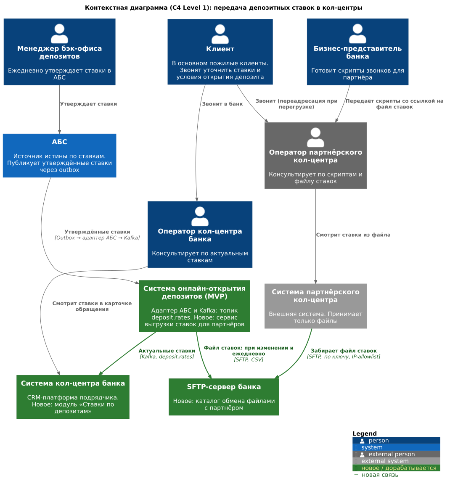
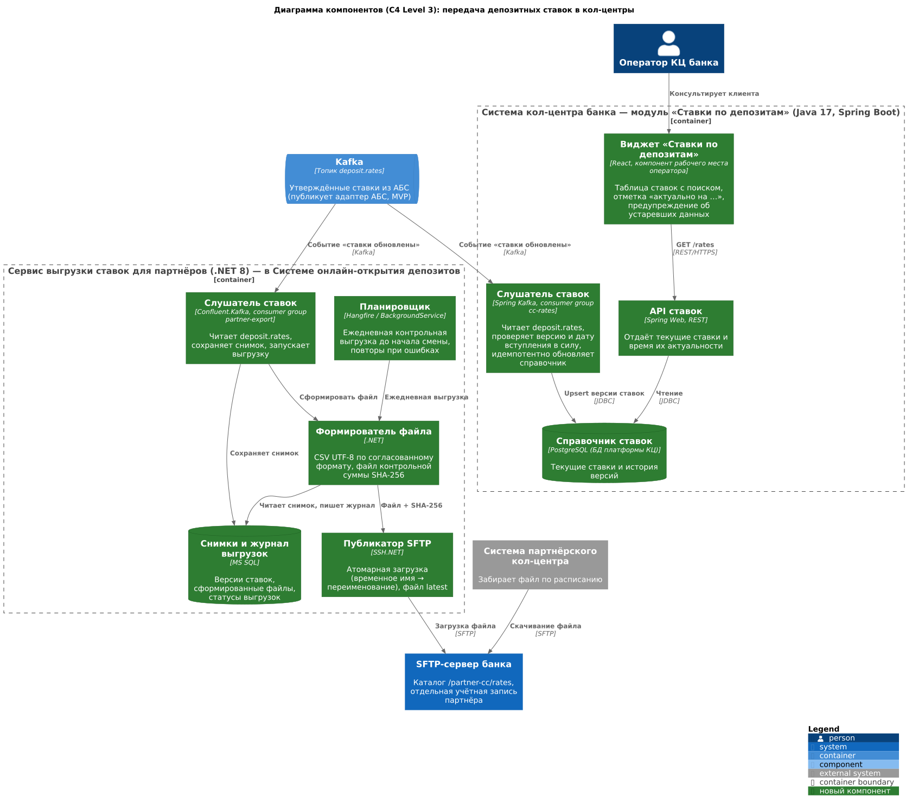

### **Название задачи:** Передача актуальных депозитных ставок в кол-центр банка и партнёрский кол-центр (MVP)
### **Автор:** Коротков Константин
### **Дата:** 23.10.2026

**Статус:** предложено

**Контекст.** Большинство клиентов банка — пожилые люди. После запуска маркетинговой кампании по депозитам ожидается рост звонков: клиенты захотят уточнить ставки и условия открытия депозита по телефону. Сейчас у операторов кол-центра банка нет доступа к ставкам, а партнёрский кол-центр работает во внешней системе только по скриптам. Партнёр готов получать ставки в виде файлов, API-интеграция с ним невозможна.

В MVP онлайн-открытия депозитов (отдельный ADR) ставки уже публикуются так: бэк-офис утверждает ставки в АБС → АБС пишет событие в outbox → адаптер АБС публикует его в топик Kafka `deposit.rates`. Решение строится на этом процессе. Источник ставок не меняется, к топику подключаются два новых потребителя.

### **Функциональные требования**

|**№**|**Действующие лица или системы**|**Use Case**|**Описание**|
| :-: | :- | :- | :- |
|UC1|Менеджер бэк-офиса депозитов, АБС, адаптер АБС, Kafka|Публикация утверждённых ставок (существующий процесс MVP)|1. Менеджер утверждает ставки на день в АБС. 2. АБС пишет событие «Ставки обновлены» в outbox: версия, дата вступления в силу, список ставок по продуктам, срокам и суммам. 3. Адаптер АБС публикует событие в топик `deposit.rates`.|
|UC2|Система КЦ банка (модуль «Ставки по депозитам»), Kafka|Получение ставок системой кол-центра банка|1. Слушатель модуля КЦ читает событие из `deposit.rates`. 2. Проверяет, что версия новее сохранённой, и дату вступления в силу. 3. Идемпотентно сохраняет версию ставок в справочник PostgreSQL. Предыдущая версия уходит в историю. 4. При ошибке обработки событие повторно читается из Kafka, справочник продолжает отдавать последнюю корректную версию.|
|UC3|Клиент, оператор КЦ банка, система КЦ банка|Консультация клиента по ставкам в кол-центре банка|1. Клиент звонит в банк. 2. Оператор открывает виджет «Ставки по депозитам» в рабочем месте. 3. Виджет показывает текущие ставки и время их актуальности. Если данные старше установленного порога, виджет предупреждает об этом. 4. Оператор консультирует клиента. Если клиент готов, оператор создаёт обращение или заявку по процессу MVP.|
|UC4|Сервис выгрузки ставок, Kafka, SFTP-сервер банка|Формирование и публикация файла ставок для партнёра|1. Слушатель сервиса выгрузки читает событие из `deposit.rates` и сохраняет снимок ставок. 2. Формирователь создаёт CSV-файл `deposit_rates_<дата>_v<версия>.csv` и файл контрольной суммы SHA-256. 3. Публикатор загружает файл на SFTP-сервер банка под временным именем, затем переименовывает его, чтобы партнёр не забрал недописанный файл. Обновляется `deposit_rates_latest.csv`. 4. Результат выгрузки фиксируется в журнале.|
|UC5|Планировщик сервиса выгрузки, SFTP-сервер банка|Ежедневная контрольная выгрузка|1. Каждый день до начала смены партнёра (например, в 07:30) планировщик формирует файл по последней версии ставок, даже если она не менялась. 2. Так партнёр каждое утро получает файл с текущей датой и может убедиться, что ставки актуальны.|
|UC6|Система партнёрского КЦ, оператор партнёрского КЦ, клиент|Получение файла партнёром и консультация клиента|1. Система партнёра по расписанию (каждые 15 минут) подключается к SFTP-серверу банка по ключу со своего IP-адреса. 2. Скачивает новый файл, сверяет контрольную сумму и загружает ставки в свою систему. 3. Оператор партнёра консультирует клиента по скрипту, используя ставки из файла и сообщая дату их актуальности. 4. Вопросы о персональных или особых условиях оператор переводит в кол-центр банка.|
|UC7|Сервис выгрузки ставок, ответственный сотрудник|Повторная выгрузка при сбое|1. Публикатор фиксирует результат каждой выгрузки в журнале. 2. При ошибке формирования или загрузки файла планировщик автоматически повторяет выгрузку. 3. Если повторы не помогли, ответственный сотрудник по журналу находит неудачную выгрузку и запускает её повторно вручную.|
|UC8|Бизнес-представитель банка, партнёрский КЦ|Обновление скриптов для партнёра|1. Бизнес-представитель обновляет скрипты звонков: где искать ставки, как называть дату актуальности, когда переводить звонок в банк. 2. Передаёт скрипты партнёру по текущему процессу.|

**Функциональные требования в формате FURPS+**

| Код | Требования | Комментарий |
|-----|------------|-------------|
| F   | Функциональные (Functionality) | |
| F1  | **[АЗТ]** Оператор кол-центра банка видит актуальные базовые ставки по депозитам в интерфейсе системы кол-центра | Сейчас у системы КЦ нет доступа к ставкам. Нужна новая интеграция платформы КЦ с источником ставок |
| F2  | Вместе со ставками отображаются дата и время их актуальности, а при устаревании данных — предупреждение | Оператор не должен называть клиенту устаревшую ставку без предупреждения |
| F3  | **[АЗТ]** Партнёрский кол-центр получает файл с актуальными ставками при каждом изменении ставок и ежедневно до начала смены | Ежедневный файл подтверждает актуальность, даже если ставки не менялись |
| F4  | Файл содержит: продукт, срок, минимальную и максимальную сумму, валюту, ставку, дату вступления в силу, версию | Формат — CSV UTF-8 с заголовком, разделитель «;». Согласуется с партнёром |
| F5  | К файлу прилагается контрольная сумма SHA-256. В имени файла указаны дата и версия | Защита от повреждённых и устаревших файлов |
| F6  | **[АЗТ]** Партнёру передаются только публичные базовые ставки. Персональные ставки и данные клиентов не передаются | Персональные ставки зависят от данных клиента и кредитного риска, их нельзя передавать во внешнюю организацию |
| F7  | Результат каждой выгрузки фиксируется в журнале. При сбое выгрузку можно повторить | Позволяет восстановить выгрузку и подтвердить, какой файл был опубликован для партнёра |
| F8  | Скрипты партнёра описывают работу с файлом ставок и правила перевода звонка в банк | Вопросы о персональных и особых условиях переводятся в кол-центр банка |

### **Нефункциональные требования**

Нефункциональные требования и ограничения в формате FURPS+. Пометка **[АЗТ]** означает архитектурно значимое требование.

| Код | Требования | Комментарий |
|-----|------------|-------------|
| U   | Удобство использования (Usability) | |
| U1  | Оператор находит нужную ставку во время разговора не больше чем за 2 действия (поиск или фильтр по продукту и сроку) | Клиенты в основном пожилые, разговоры долгие. Быстрый поиск сокращает время звонка |
| U2  | Виджет ставок соответствует дизайн-системе банка | Единый вид с остальными интерфейсами банка |
| R   | Надёжность (Reliability) | |
| R1  | **[АЗТ]** Доступность ставок в системе КЦ банка — 99,9% в рабочее время кол-центра. При недоступности Kafka или источника ставок система КЦ показывает последнюю сохранённую версию с отметкой времени | Определяет хранение локальной копии ставок в платформе КЦ |
| R2  | **[АЗТ]** Обработка событий ставок идемпотентна: повтор события не создаёт дублей версий и повторных файлов той же версии | Kafka гарантирует доставку «хотя бы один раз», поэтому повторы возможны |
| R3  | При ошибке формирования или загрузки файла выполняются автоматические повторы | Партнёр не должен остаться без файла из-за кратковременного сбоя |
| P   | Производительность (Performance) | |
| P1  | **[АЗТ]** Новые ставки появляются в системе КЦ банка не позже чем через 5 минут, а на SFTP-сервере для партнёра — не позже чем через 15 минут после утверждения в АБС | Значения предварительные, требуют согласования с бизнесом |
| P2  | Виджет ставок открывается не дольше 1 секунды | Согласуется с требованием MVP к загрузке справочных данных |
| P3  | **[АЗТ]** Новые потребители ставок не создают дополнительной нагрузки на АБС | БД АБС перегружена и масштабируется только вертикально. Ставки берутся только из топика Kafka `deposit.rates` |
| S   | Поддерживаемость (Supportability) | |
| S1  | Формат файла версионируется и описан в спецификации для партнёра. Изменение формата согласовывается заранее | Иначе изменение формата сломает загрузку у партнёра |
| S2  | Файлы и журнал выгрузок хранятся не меньше 90 дней | Позволяет подтвердить, какие ставки были у партнёра в конкретный момент, и разобрать претензии клиентов |
| +R  | + Ограничения (Restrictions) | |
| R+1 | **[АЗТ]** Интеграция с партнёром только файловая, через SFTP. API-вызовы не используются | Партнёр работает во внешней системе и готов принимать только файлы |
| R+2 | **[АЗТ]** Обмен с партнёром через SFTP-сервер в DMZ: отдельная учётная запись только на чтение своего каталога, аутентификация по SSH-ключу, ограничение по IP-адресу, журналирование доступа | Партнёр не получает доступа во внутреннюю сеть банка |
| R+3 | **[АЗТ]** Использовать технологии, уже принятые в банке: Java/Spring Boot и PostgreSQL в платформе КЦ, .NET 8 и MS SQL для сервиса выгрузки, Kafka для доставки событий | Требование банка о совместимости технологий и наличии экспертизы |
| R+4 | **[АЗТ]** Источник ставок — утверждённые в АБС ставки, которые публикуются в топик `deposit.rates` по процессу MVP | Решение строится на текущем процессе работы со ставками. Срок запуска зависит от готовности этого потока |

### **Решение**

На диаграммах показаны только элементы, которые участвуют в передаче ставок. Каналы клиентов (сайт, интернет-банк) и процесс приёма заявок описаны в ADR MVP.

#### Диаграмма контекста (C4, уровень 1)

#### Диаграмма компонентов (C4, уровень 3)

#### Компоненты решения

| Элемент | Статус | Технологии | Ответственность |
| :- | :- | :- | :- |
| Топик `deposit.rates` | Существует (MVP) | Kafka | Единый поток утверждённых ставок из АБС |
| Модуль «Ставки по депозитам» в системе КЦ банка | Новый | Java 17, Spring Boot, Spring Kafka, PostgreSQL, React | Слушатель ставок, справочник ставок с историей версий, REST API, виджет в рабочем месте оператора |
| Сервис выгрузки ставок для партнёров | Новый, в Системе онлайн-открытия депозитов | .NET 8, Confluent.Kafka, SSH.NET, MS SQL | Снимки ставок, формирование CSV и контрольной суммы, публикация на SFTP, ежедневная выгрузка, журнал выгрузок |
| SFTP-сервер банка | Новый (или выделенный каталог на существующем) | OpenSSH SFTP, DMZ | Точка обмена файлами с партнёром |
| Система партнёрского КЦ | Внешняя, без изменений со стороны банка | — | Забирает файл по расписанию, проверяет контрольную сумму, показывает ставки операторам |

#### Логика принятых решений

| Решение | Обоснование | Требования |
| :- | :- | :- |
| Брать ставки из топика `deposit.rates`, а не из АБС | Источник и процесс утверждения ставок не меняются. Новые потребители не нагружают перегруженную БД АБС, а все каналы видят одну и ту же версию ставок | P3, P1, R+4 |
| Модуль ставок внутри платформы КЦ как Kafka-consumer с локальным справочником | Платформа КЦ микросервисная, расширяемая и в MVP уже читает Kafka (заявки с сайта). Локальная копия позволяет показывать ставки, даже если Kafka или источник недоступны, и даёт быстрый отклик | F1, F2, R1, P2, R+3 |
| Отдельный сервис выгрузки, а не формирование файлов в АБС или в платформе КЦ | АБС не нагружается, платформа КЦ сопровождается подрядчиком и не должна отвечать за обмен с внешним партнёром. Сервис в Системе онлайн-открытия депозитов использует уже принятые .NET 8 и MS SQL | P3, R+3, F3 |
| SFTP-сервер банка в DMZ, партнёр сам забирает файл (pull) | Партнёр не попадает во внутреннюю сеть. Банку не нужно хранить учётные данные партнёра и открывать исходящие соединения во внешнюю сеть. Одна точка подключения подойдёт и для будущих партнёров | R+1, R+2 |
| Выгрузка по событию плюс ежедневная контрольная выгрузка | По событию партнёр быстро получает изменения, а ежедневный файл подтверждает актуальность, даже если ставки не менялись | F3, P1 |
| CSV UTF-8, версия и дата в имени, SHA-256, атомарная загрузка | Простой формат, который партнёр может загрузить в любую систему. Версия и контрольная сумма защищают от устаревших и повреждённых файлов. Атомарная загрузка исключает чтение недописанного файла | F4, F5, R2, S1 |
| Передавать партнёру только базовые ставки | Персональные ставки зависят от данных клиента и кредитного риска. Их нельзя передавать во внешнюю организацию | F6, R+2 |
| Журнал выгрузок и автоматические повторы | Сбой выгрузки не оставит партнёра без файла, а журнал подтверждает, какие ставки были опубликованы, и помогает разбирать претензии клиентов | F7, R3, S2 |

#### Порядок внедрения (для дорожной карты)

1. **Команда АБС:** публикация утверждённых ставок через outbox, адаптер АБС и топик `deposit.rates`. Это общая зависимость, она входит в MVP и должна быть готова первой.
2. **Команда интернет-банка (.NET) и IT-инфраструктура (параллельно):** сервис выгрузки ставок; SFTP-сервер в DMZ, учётная запись и сетевой доступ партнёра.
3. **Подрядчик КЦ или Java-специалисты команды АБС (параллельно с п. 2):** модуль «Ставки по депозитам» в платформе КЦ.
4. **Бизнес и партнёр:** согласование формата файла, настройка загрузки на стороне партнёра, обновление скриптов, тестовый обмен.
5. **Запуск маркетинговой кампании** только после того, как оба кол-центра получают актуальные ставки.

### **Альтернативы**

| Альтернатива | Почему отклонена |
| :- | :- |
| Система КЦ синхронно запрашивает ставки у сервиса депозитных заявок по REST | Рабочий вариант, но при недоступности сервиса операторы остаются без ставок в момент разговора. Kafka-consumer с локальной копией надёжнее и уже используется платформой КЦ |
| Операторы смотрят ставки на публичном сайте банка | Самый дешёвый вариант, но ставки не встроены в рабочее место оператора, нет контроля версии и времени актуальности. Можно использовать как временный резервный канал |
| Бэк-офис отправляет партнёру Excel-файл по почте, как сейчас внутри банка | Ручной процесс с риском ошибок и задержек, нет контроля доставки и версий, почта не защищённый канал обмена с внешней организацией |
| Банк сам загружает файл на SFTP-сервер партнёра (push) | Даёт мгновенное подтверждение доставки, но требует исходящих соединений из банка во внешнюю сеть и хранения учётных данных партнёра. Можно вернуться к варианту, если партнёр не сможет забирать файлы сам |
| Формировать файл в АБС (PL/SQL, выгрузка по расписанию) | Добавляет нагрузку на перегруженную БД АБС и работу команде АБС. Нарушает P3 |

**Недостатки, ограничения, риски**

| № | Риск или ограничение | Влияние | Митигация |
| :-: | :- | :- | :- |
| 1 | Партнёр забирает файл по расписанию, ставки у него обновляются с задержкой | При изменении ставок в течение дня оператор партнёра до 15 минут называет прежнюю ставку | Опрос каждые 15 минут, дата и время актуальности в файле и скрипте, ставки вступают в силу не раньше публикации |
| 2 | Партнёр может не загрузить файл или ошибиться при загрузке | Консультации по устаревшим ставкам, репутационный риск | Ежедневный файл, проверка контрольной суммы на стороне партнёра, журнал выгрузок, сверка на тестовом обмене перед запуском |
| 3 | Решение зависит от потока ставок из MVP (outbox, адаптер АБС, Kafka) | Без него ставки не дойдут ни до одного кол-центра, срок запуска привязан к MVP | Поставить публикацию ставок первой в дорожную карту. Временный резервный канал — публичный сайт |
| 4 | Доработка платформы КЦ зависит от подрядчика или загруженных Java-специалистов команды АБС | Риск по срокам | Небольшой изолированный модуль, раннее согласование с подрядчиком |
| 5 | Операторы партнёра видят только базовые ставки | Клиенты с особыми условиями всё равно попадают в кол-центр банка, нагрузка снижается не полностью | Правило перевода звонка в скрипте, мониторинг доли переводов |
